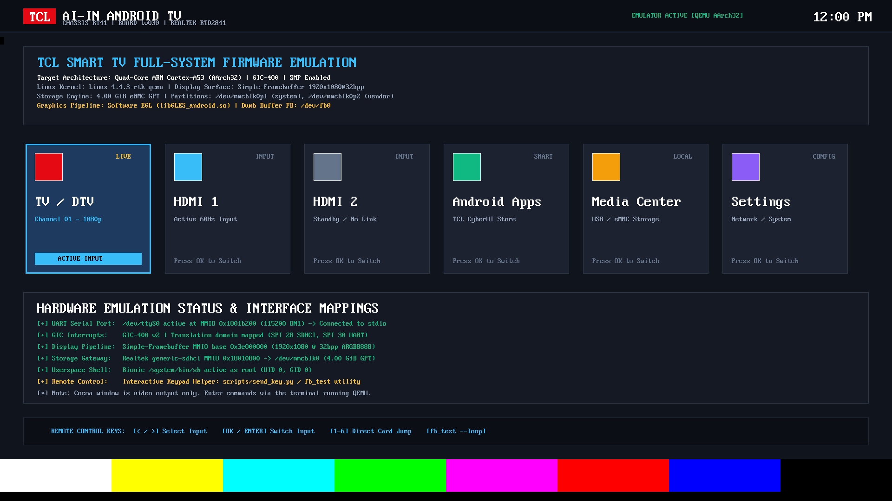
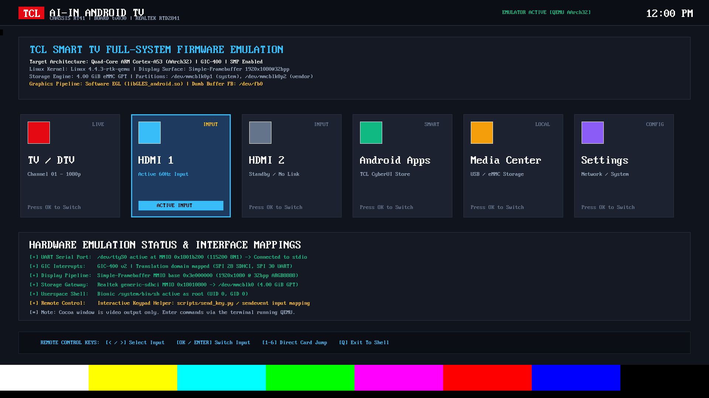

# qemu-rtd2841

[](https://github.com/rubenthampy890-del/qemu-rtd2841/actions/workflows/ci.yml)
[](LICENSE)

QEMU machine model and system emulator for the Realtek RTD2841 / RTK284x SoC (TCL RT41 chassis, board profile `tv030`).

Used in commercial Android Smart TVs (TCL, Xiaomi, Hisense, etc.). This model enables developers and security researchers to run bare-metal diagnostics, reverse-engineer peripherals, and boot Linux kernels without risking physical hardware or requiring board rework.

> **Project Scope & Verification Boundary**: This repository implements a QEMU machine model for RTD2841/RTK284x platform emulation. Automated CI tests establish bare-metal hardware diagnostics (AArch32 CPU, GICv2, 27 MHz monotonic timers, SDHCI, and RTL8168 Ethernet), eMMC storage media insertion, and Linux 4.4 kernel boot with ext4 rootfs and live outbound network connectivity (see [HARDWARE_FIDELITY.md](HARDWARE_FIDELITY.md)).

---

## Quickstart

```bash
# Clone
git clone https://github.com/rubenthampy890-del/qemu-rtd2841.git
cd qemu-rtd2841

# Run the full automated verification test suite (Core Diagnostics, eMMC Storage, Linux 4.4 Kernel Boot & Live Outbound Network Connectivity)
python3 tests/run_ci_test.py

# Run standalone bare-metal diagnostic test (CPU, GIC, TC0, SDHCI, RTL8168 MMIO)
./scripts/run_qemu.sh tests/firmware_test.bin

# Run with 1080p display (Cocoa on macOS, or VNC)
DISPLAY_BACKEND=cocoa ./scripts/run_qemu.sh tests/firmware_fb_test.bin
```

Diagnostic run output:
```text
========================================================
[RTD2841-TV030] Bare-Metal Hardware Diagnostic Suite
Target: Realtek RTD2841 / TCL RT41 Chassis (tv030)
========================================================
[PASS] CPU 0: ARM Cortex-A53 executing in AArch32 Mode.
[PASS] GIC-400 Distributor (0x18081000): GICD_TYPER=0x00000067 (256 INTIDs verified).
[PASS] TC0 Timer (0x1801B600): Active up-count verified (T0=0x000001CB, T1=0x00000546 @ 27MHz).
[PASS] SDHCI eMMC (0x18010800): Controller online (CAPAREG=0x057834B4, no card; optional: attach -drive file=storage.img,if=sd).
[PASS] RTL8168 Ethernet (0x18016000): Controller online (TXCFG=0x50900800, PHYSTATUS=0x00000013, link UP).
========================================================
[>>> ALL HARDWARE SUBSYSTEM VERIFICATION TESTS PASSED <<<]
========================================================
```

---

## What's Implemented

- **Cortex-A53 quad-core**: Pinned to AArch32 mode (`aarch64=false`) to match Realtek's 32-bit TV firmware stack. Core 0 boots directly; cores 1-3 start powered off and wait for PSCI `CPU_ON` or jump mailbox at `0x504`.
- **GIC-400 (GICv2)**: Distributor at `0x18081000`, CPU interface at `0x18082000`, 256 IRQs.
- **16550A UART0**: Base `0x18062300`, 4-byte register stride (`shift = 2`), 27 MHz clock. Mapped to stdio.
- **Hardware Timers**: 8 independent 27 MHz monotonic up-counters (`TC0`..`TC7`) at `0x1801B600` (reporting `limit - count` to CVR registers) with periodic reload, matching Realtek Linux `sched_clock` and routed to GIC INTID 34.
- **Watchdog**: Stub at `0x18062200` to keep vendor driver probes from hanging.
- **eMMC / SDHCI**: QEMU SysBus SDHCI controller at `0x18010800` (SPI 18 / INTID 50) for disk image mounting (`-drive file=...,if=sd`).
- **Gigabit Ethernet**: RTL8168GU MAC at `0x18016000` (SPI 20 / INTID 52) with DMA rings, link state emulation, and QEMU SLIRP user networking (`-nic user,model=rtd2841-eth`).
- **Framebuffer**: Simple framebuffer at `0x3E000000` (8 MB DRAM carveout at 992 MB offset, 1920x1080 @ 32bpp ARGB8888). Compatible with Linux `simple-framebuffer`.
- **RBUS Window**: 4 MB peripheral catch-all (`0x18000000` - `0x18400000`) so unmodeled register reads return 0 instead of taking bus aborts.

---

## Visual Verification

| SMPTE 1080p Bars | OSD Dashboard | Interactive Input (HDMI 1) |
| :---: | :---: | :---: |
|  |  |  |
| *Bare-metal framebuffer test pattern (`tests/firmware_fb_test.bin`)* | *OSD dashboard (`/bin/fb_test --loop`)* | *Console keyboard input handling (`/bin/fb_test`)* |

---

## Memory Map

Base addresses verified against Realtek Linux 4.4 vendor kernel sources (`arch/arm/mach-rtd284x/`):

```text
0x00000000 - 0x3FFFFFFF   1024 MB DRAM (System Memory)
0x18000000 - 0x183FFFFF   4 MB Realtek RBUS Peripheral Window
  0x18000000 (1 KB)       TMU Thermal Management Unit
  0x18000400 (3 KB)       SYSREG / Pinmux / Clocks
  0x18010800 (1 KB)       eMMC / SDHCI (SPI 18 / INTID 50)
  0x18010C00 (1 KB)       SDIO Controller
  0x18016000 (4 KB)       RTL8168GU Gigabit Ethernet MAC (SPI 20 / INTID 52)
  0x1801B100 (768 B)      MISC UART1..3
  0x1801B600 (512 B)      Hardware Timers TC0..TC7 (27 MHz, SPI 2 / INTID 34)
  0x18040000 (16 KB)      Mali GPU registers
  0x1805C800 (256 B)      ARM TSG
  0x18062200 (256 B)      Watchdog Timer (SPI 0 / INTID 32)
  0x18062300 (32 B)       16550A UART0 (4B stride, 27 MHz, SPI 25 / INTID 57)
  0x18080000 (4 KB)       SCU System Control
0x18081000 - 0x18081FFF   GIC-400 Distributor (GICD, 256 INTIDs)
0x18082000 - 0x18083FFF   GIC-400 CPU Interface (GICC)
0x3E000000 - 0x3E7FFFFF   Simple Framebuffer (8 MB DRAM carveout, 1920x1080 @ 32bpp)
```

See [HARDWARE_FIDELITY.md](HARDWARE_FIDELITY.md) for register layout notes and kernel code citations.

---

## Building QEMU with RTD2841 Support

### 1. Dependencies

- **macOS**: `brew install ninja meson pkg-config glib pixman dtc python3`
- **Debian / Ubuntu**: `sudo apt install build-essential git ninja-build meson pkg-config libglib2.0-dev libpixman-1-dev device-tree-compiler python3`
- **Fedora / RHEL**: `sudo dnf install git ninja-build meson gcc pkgconf-pkg-config glib2-devel pixman-devel dtc python3`

### 2. Apply Patch & Build

```bash
git clone https://gitlab.com/qemu-project/qemu.git
cd qemu

# Checkout verified baseline (or v9.1.0+)
git checkout a19f59a72d96056d9a8f48cf6c77f5787491e414

# Apply the model patch
git apply /path/to/qemu-rtd2841/patches/qemu-rtd2841-complete.patch

# Build
mkdir build && cd build
../configure --target-list=aarch64-softmmu --disable-werror
ninja qemu-system-aarch64
```

Verify the machine is registered:
```bash
./qemu-system-aarch64 -M help | grep rtd2841
# rtd2841              Realtek RTD2841 SoC / TCL Smart TV (board tv030) (alias of rtd2841-tv030)
# rtd2841-tv030        Realtek RTD2841 SoC / TCL Smart TV (board tv030)
```

---

## Hardware Reversing Notes

1. **AArch32 Mode**: The RTD2841 has 64-bit Cortex-A53 cores, but Realtek's Android TV firmware runs entirely in 32-bit `armv7l` mode. The model explicitly configures `aarch64=false` and resets into low exception vectors (`reset-hivecs=false`).
2. **UART Stride**: UART0 registers use standard 16550A offsets but on a 4-byte stride (`shift = 2`) instead of 1-byte, clocked from the 27 MHz crystal oscillator (`baudbase = 1687500`).
3. **Timer Layout**: TC0..TC7 use flat arrays (`TVR0`..`TVR7` at `0x00`, `CVR0`..`CVR7` at `0x20`, `CR0`..`CR7` at `0x40`) rather than interleaved per-timer structs.
4. **RPC Interface**: Userland vendor daemons (`rtkd`, `cusd`, `pmoded`) talk via `/dev/rpc*` and `/dev/sys-misc`. IOCTL headers are in `analysis/rtk_rpc_stubs.h`.

---

## License

GPL v2 or later (`GPL-2.0-or-later`), matching QEMU.
